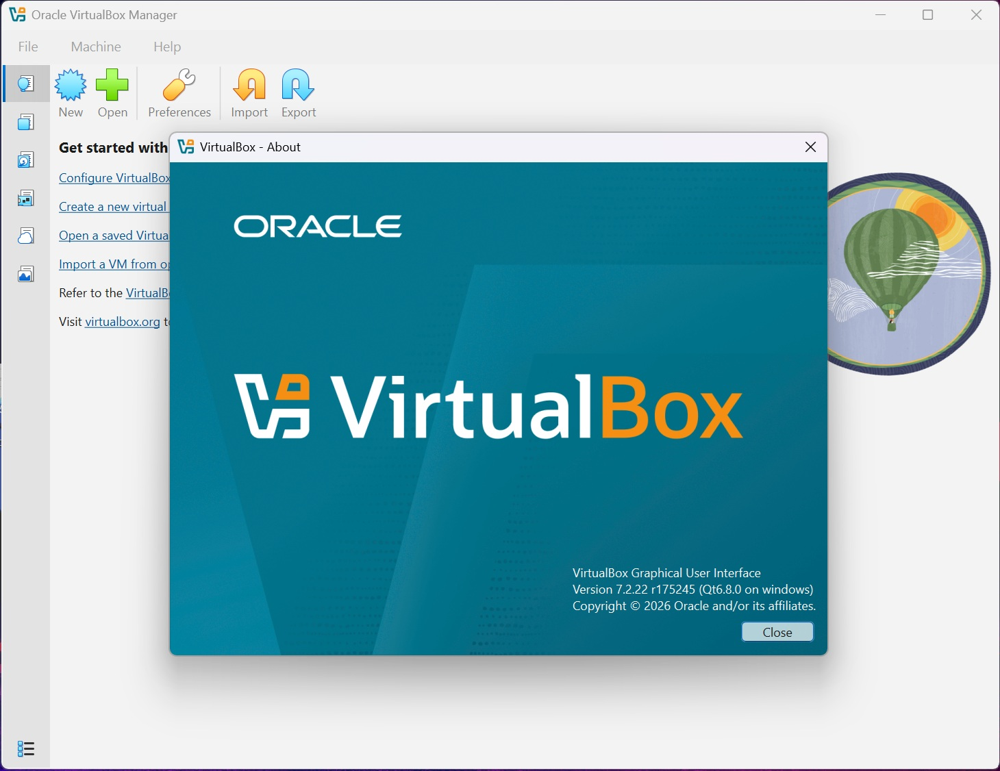
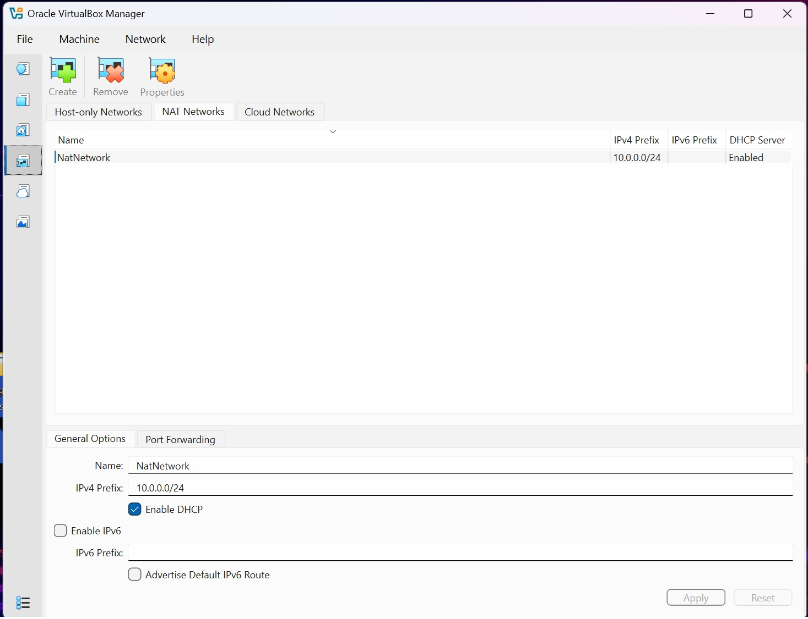
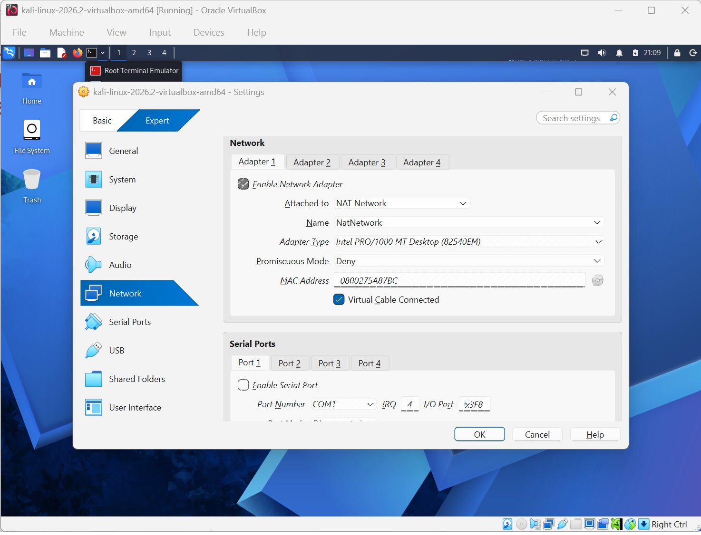
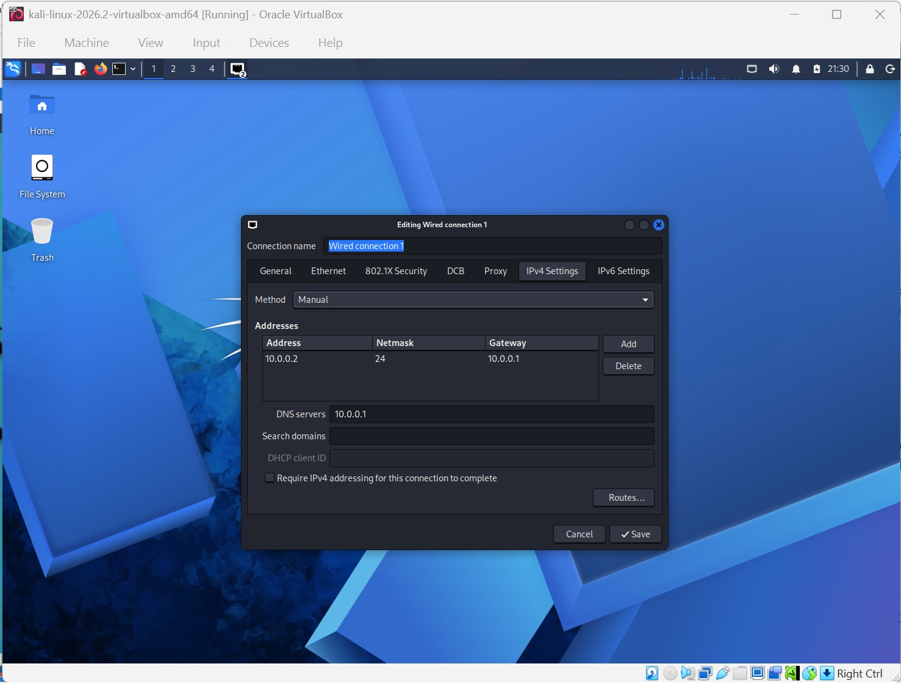
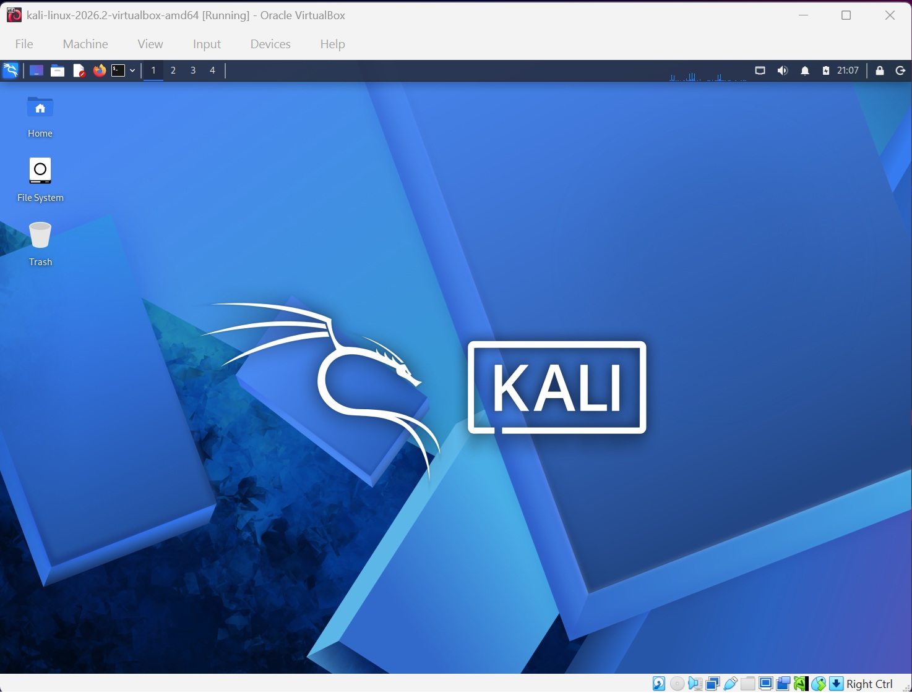

# NETWORKWALKS-EMMANUEL-B084-WK1-PM1-CYBERSECURITY-LAB-SETUP
Cybersecurity Lab Setup and Virtual Environment Configuration with Kali Linux
# 🔐 Cybersecurity Lab Environment Setup

## 📖 Overview

This project documents the creation of my personal cybersecurity lab using Oracle VirtualBox and Kali Linux. The goal of the lab is to provide a safe and isolated environment for learning networking, system administration, cybersecurity fundamentals, vulnerability assessment, and ethical hacking concepts.

The lab uses a dedicated VirtualBox NAT Network to support future virtual machines while maintaining internet access.

---

# ⚙️ My Lab Configuration

| Component | Configuration |
|------------|---------------|
| 🖥️ Host OS | Windows 11 Pro |
| 🧠 Host RAM | 32 GB |
| ⚡ Processor | Intel(R) Core(TM) i9-14900HX (2.20 GHz) |
| 🧰 Hypervisor | VirtualBox 7.2.22 |
| 🐉 Security OS | Kali Linux 2026.2 |
| 🧠 Kali RAM | 2048 MB |
| 🌐 Virtual Network | NAT Network |
| 📡 Network Address | 10.0.0.0/24 |
| 🐧 Kali IP Address | 10.0.0.2/24 |
| 🚪 Default Gateway | 10.0.0.1 |
| 🌍 DNS Server | 8.8.8.8 |
| 🔮 Future VM Range | 10.0.0.3 - 10.0.0.99 |

---

# 🛠️ Lab Setup Process

## Step 1 - Install VirtualBox

Oracle VirtualBox was installed on the Windows 11 host machine and used as the virtualization platform for this lab.

<p align="center">
  
</p>

### Version Installed

```text
Oracle VirtualBox 7.2.22
```

This version provides the virtualization and networking features required for the cybersecurity laboratory.

---

## Step 2 - Create a NAT Network

A dedicated NAT Network was created in VirtualBox. This allows virtual machines to communicate with each other while maintaining access to external networks.

<p align="center">
  
</p>

### NAT Network Settings

```text
Network Name : NatNetwork
IPv4 Prefix  : 10.0.0.0/24
DHCP         : Enabled
IPv6         : Disabled
```

Using a dedicated NAT Network provides flexibility for future attacker and target virtual machines that may be added to the lab environment.

---

## Step 3 - Configure Kali Linux Network Adapter

After importing the Kali Linux virtual machine, the network adapter was connected to the previously created NAT Network.

<p align="center">
  
</p>

### Adapter Configuration

```text
Adapter 1            : Enabled
Attached To          : NAT Network
Network Name         : NatNetwork
Adapter Type         : Intel PRO/1000 MT Desktop
Promiscuous Mode     : Deny
Virtual Cable        : Connected
```

This configuration allows Kali Linux to communicate through the virtual network and access future lab machines.

---

## Step 4 - Configure Static IPv4 Address

A static IP address was configured inside Kali Linux to maintain consistent network identification throughout future labs.

<p align="center">
  
</p>

### Network Configuration

```text
IP Address : 10.0.0.2
Subnet     : /24
Gateway    : 10.0.0.1
DNS        : 8.8.8.8
```

Using a static IP address makes future network documentation and troubleshooting easier.

---

## Step 5 - Verify Kali Linux Installation

After completing the networking configuration, Kali Linux was started successfully and verified to be functioning correctly.

<p align="center">
  
</p>

The operating system booted successfully and was ready for additional cybersecurity lab exercises.

---

# 🔧 Troubleshooting

## Network Connectivity Issue

During the setup process, Kali Linux experienced network connectivity issues after assigning a static IPv4 address.

The issue was resolved using the following command:

```bash
sudo nmcli connection modify "Wired connection 1" ipv4.dad-timeout 0
```

After reconnecting the interface, network connectivity was restored successfully.

---

# ✅ Lab Verification

The following checks were performed after completing the configuration:

### Verify IP Address

```bash
ip addr
```

Expected:

```text
10.0.0.2/24
```

### Verify Gateway Connectivity

```bash
ping 10.0.0.1
```

Successful replies confirmed communication with the gateway.

### Verify Internet Connectivity

```bash
ping 8.8.8.8
```

Successful replies confirmed external connectivity.

---

# 📚 What I Learned

Through this lab setup, I learned:

- Installing and configuring Oracle VirtualBox
- Creating and managing NAT Networks
- Importing and configuring Kali Linux virtual machines
- Static IPv4 network configuration
- Gateway and DNS configuration
- Virtual machine networking concepts
- Basic network troubleshooting using Kali Linux
- The importance of documenting technical configurations

---

# 🚀 Future Improvements

Planned additions to the lab include:

- Additional vulnerable virtual machines
- Windows client systems
- Internal network segmentation
- Wireshark traffic analysis
- Nmap network scanning exercises
- Web application testing environments

---

# ⚠️ Ethical Use Statement

This laboratory is intended solely for educational and authorized cybersecurity learning. Any testing activities should only be performed on systems that are owned by the user or where explicit permission has been provided.

---

# 👨‍💻 Author

**Mohammad Shah**

Cybersecurity Student  
NetworkWalks Cybersecurity and Ethical Hacking Internship Program
